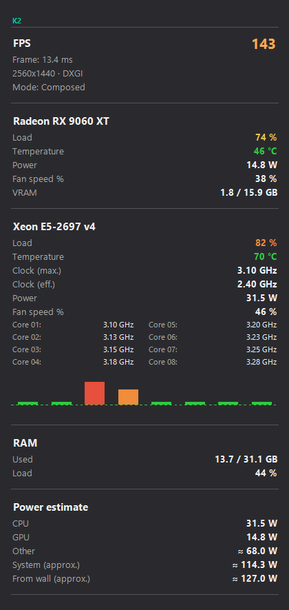
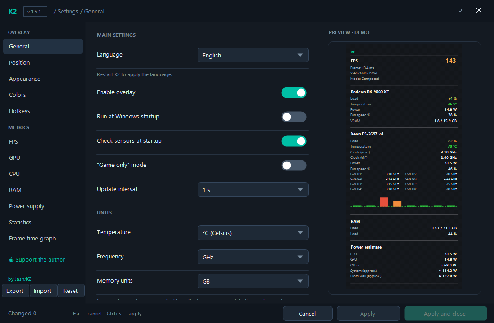
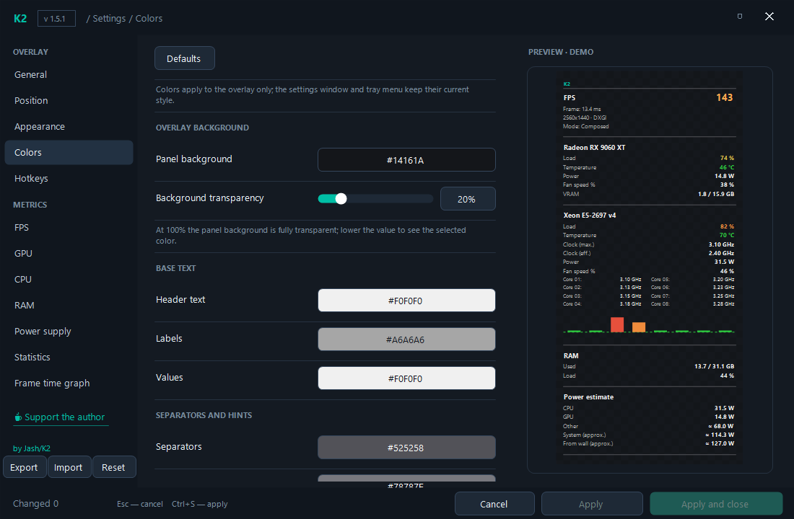
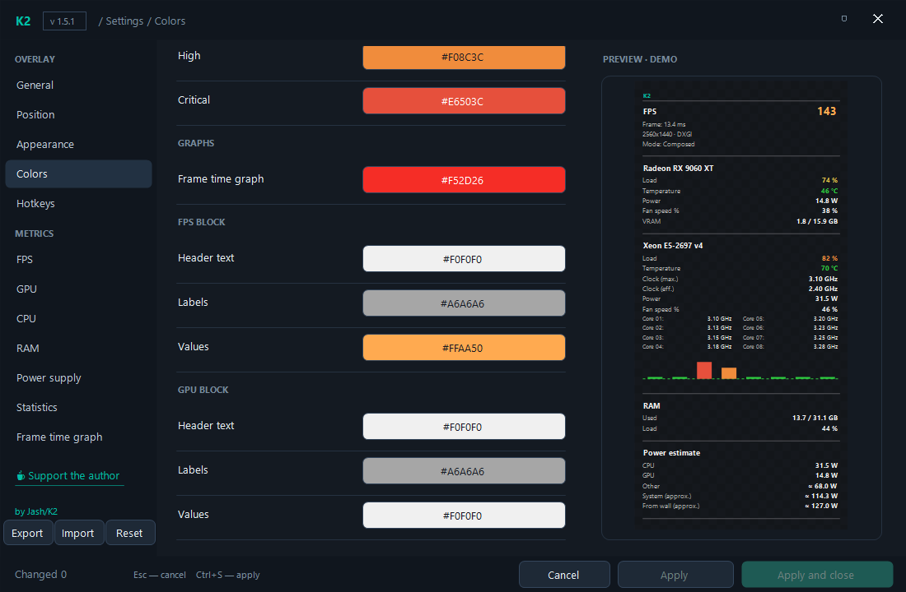
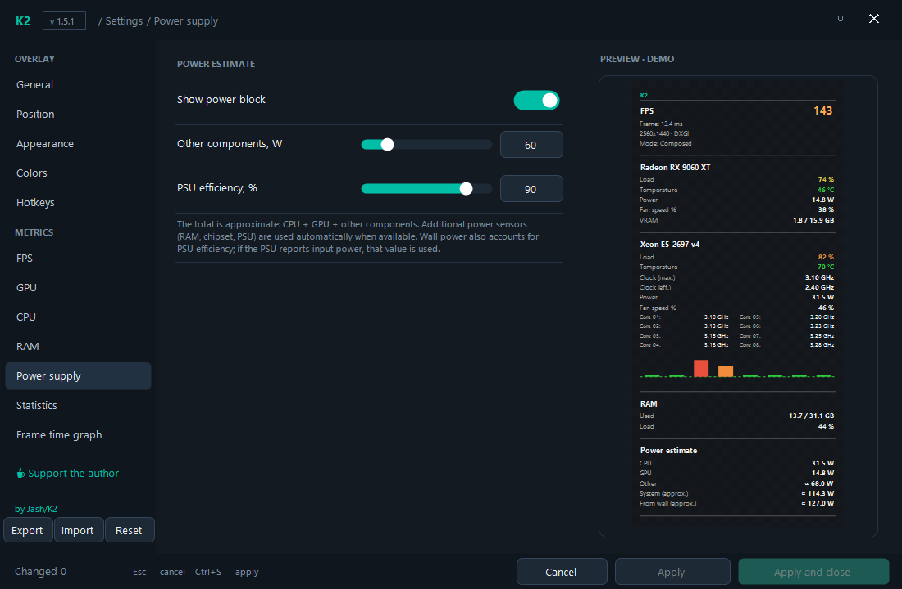

# K2

A lightweight system-monitoring overlay widget for Windows — GPU, CPU (with
per-core frequency table and per-thread load graph) and RAM, always on top,
fully configurable.











## Features

- Dark borderless widget, always on top, draggable, remembers position
- GPU: load / temperature (color zones) / hotspot / memory temp / clocks /
  voltage / power / fan / VRAM
- CPU: load / temperature / frequency / effective frequency / power /
  per-core frequency table / per-logical-core load graph
- RAM: used / total / percent
- Session statistics (min/max), history window (click the core graph)
- Settings window: block order, units, size, scale, opacity, corner radius,
  fonts, global hotkeys, "game only" mode
- Tray **Move / resize** mode: drag to move, drag edges/corners to resize; the
  overlay is fixed outside this mode. **Fit to content** and auto width shrink
  it to the visible blocks
- In normal mode the overlay is click-through — it does not block mouse clicks
  on the window underneath
- Approximate system power: CPU + GPU + other components, plus an estimate from
  the wall using PSU efficiency; additional power sensors (RAM, chipset, PSU)
  are detected automatically
- Overlay color scheme: panel background (with a transparency slider), headers,
  labels, values, separators, accents, load/temperature zones and the
  frame-time graph; each overlay block (FPS, GPU, CPU, RAM, Statistics) can set
  its own header/label/value colors. A **Defaults** button restores the current
  look (overlay only)
- Safe limits for every setting: broken/hand-edited INI values are clamped
  instead of crashing the overlay
- Single-instance protection (a second launch does not duplicate the overlay)
- Optional autostart at logon through Task Scheduler: starts elevated without a
  UAC prompt
- CSV session log (`%LOCALAPPDATA%\K2\log\`), settings export/import
- All sensor data from
  [LibreHardwareMonitor](https://github.com/LibreHardwareMonitor/LibreHardwareMonitor)
- No telemetry; the only external action is opening the donation link in your
  browser when you click it

## Language

The interface ships in English and Russian. Switch it in
**Settings → General → Language** or from the tray menu → **Language**.
The choice is stored as `ui.lang` (`en` / `ru`) in
`%LOCALAPPDATA%\K2\settings.ini`; K2 offers to restart itself right away
(button **Restart** / **Перезагрузить**), otherwise the language applies on
the next start.

## Requirements

- Windows 10 / 11 x64 with .NET Framework 4.8 (preinstalled on modern Windows)
- Administrator rights (hardware sensors are read through a kernel driver)

## Build from source

```
powershell -ExecutionPolicy Bypass -File .\resolve.ps1   # NuGet DLLs + PresentMon into lib\ and tools\
build.cmd                                                # compiles with the built-in csc.exe
```

Output: `K2.exe` in the project root (next to its DLLs) — the whole folder is portable.
No Visual Studio or .NET SDK is required.

## Run options

| Command | Action |
|---|---|
| `K2.exe` | start the overlay |
| `K2.exe --settings` | start and open settings |
| `K2.exe --dump` | write sensor dump to `%LOCALAPPDATA%\K2\sensors.txt` |

Hotkeys (configurable): Alt+F8 show/hide, F10 settings, Alt+F5 reset stats,
Alt+F7 compact mode, Alt+F11 pause/resume measuring.

## Notes & limitations

- "Effective frequency" is approximated as average core clock × load
  (MSR-based effective clocks are not exposed on all platforms).
- In-game FPS and frame time via the official Intel PresentMon tool (MIT):
  ETW frame-presentation events for the foreground process, no injection into
  games. Works with DXGI/D3D9 presentation and windowed or fullscreen games.
  "Frame time" is the displayed frame interval, not end-to-end input latency.
- Motherboard fan sensors may be unavailable on some boards — the widget
  shows "—" instead of a fake value.
- FPS is attributed to the foreground game process. A static screen keeps the
  last displayed reading for up to 10 seconds, then the block auto-hides.
- PresentMon requires elevated rights (K2 already runs as administrator). If
  `tools/PresentMon-2.4.1-x64.exe` is missing, run `resolve.ps1`.

## Changelog

### 1.5.1

- Added an approximate **Power** block: CPU + GPU + other components, and an
  estimate from the wall using PSU efficiency. Values are marked with **≈**.
  Additional power sensors (RAM, chipset, PSU input) are picked up
  automatically when present.
- Added **Settings → Power supply** with the "other components" baseline and
  PSU efficiency.
- In normal mode the overlay is now **click-through**: mouse clicks reach the
  window underneath it. Only **Move / resize** mode captures the mouse.
- Added **History** to the tray menu, so the history window remains accessible
  without clicking the overlay graph.

### 1.5.0

- Added a tray **Move / resize** mode with a visible frame: drag inside to move,
  drag edges or corners to resize. Outside this mode the overlay cannot be
  moved or resized.
- Added **Fit to content** and an **Auto width** option: the overlay width can
  follow the visible blocks instead of staying unnecessarily wide.
- Manual height is remembered after resizing; **Fit to content** restores
  automatic height.
- Fixed the overlay jumping back to the top-right corner of the primary monitor
  after a setting change when it had been moved or resized manually. Manual
  position and the current monitor are preserved.
- The Colors section now includes a **Background transparency** slider. At
  100% the panel is fully transparent (only the text remains), so the panel
  color is invisible; lower the value to see it.

### 1.4.0

- Added a **Colors** section in Settings: panel background, base text, accents,
  load/temperature zones, frame-time graph, and per-block header/label/value
  colors for FPS, GPU, CPU, RAM and Statistics. A **Defaults** button restores
  the standard look. Changes affect the overlay only.

### 1.3.0

- Added an English interface and a runtime English/Russian language switch
  (`ui.lang`, Settings → General → Language, tray → Language). Changing the
  language offers an immediate restart with the new language.
- Autostart now uses Task Scheduler with the highest available privileges, so
  K2 starts elevated at logon without a UAC prompt. The task is named
  `K2 System Monitor` and is created/removed by the "Run at Windows startup"
  toggle. The old `HKCU\...\Run` value is removed automatically.

### 1.2.0

- Replaced the Desktop Duplication FPS source with the official Intel
  PresentMon (MIT): ETW presentation events for the foreground game process.
  FPS no longer flickers on static/loading screens, does not need access
  recovery, and works for windowed and fullscreen DXGI/D3D9 games.
- FPS frame history is now time-based (last 5 seconds), 1% / 0.1% Low are
  calculated over the whole game session, and the present mode / render API
  are shown in the FPS block.
- Frequency below 1 GHz is displayed in MHz instead of "0.0 GHz".
- `resolve.ps1` downloads and SHA-256-verifies PresentMon; MIT notices added.
- Added a "☕ Support the author" link to the left settings menu under
  "Frame time graph"; it opens the author's DonationAlerts page.

### 1.1.14

- The FPS block no longer sticks to the previous game when focus moves to
  OpenCode/browser/desktop: the last reading is held only while the K2 overlay
  or its settings window is focused. Switching to another game switches the
  counter immediately; leaving to a normal app hides it.
- Added OpenCode, Cursor and Windsurf to the non-game application list.

### 1.1.13

- A 1–2 FPS reading from a static/minimized screen no longer replaces the last
  normal game reading (that was causing "2 FPS" to stick after alt-tabbing).
- Last-game values are cleared when a new game session starts.

### 1.1.12

- During desktop-duplication restarts and short focus changes the FPS block
  keeps the last real game reading instead of disappearing or showing 2 FPS
  from the desktop. When the game process ends, it hides normally.

### 1.1.11

- FPS no longer flickers while the game is running: as long as the game process
  is alive, the counter keeps working even when focus goes to the overlay, the
  second monitor or another app.
- Slight overshoots above the monitor refresh are rounded down to the refresh
  rate instead of hiding the block; only gross artifacts are discarded.
- A static/loading screen keeps the last FPS for up to 10 seconds (was 2.5 s).
- `fps_status.txt` now logs whether a restart was caused by access loss or by a
  specific `hr` error.

### 1.1.10

- FPS is now bounded by the real refresh rate of the game's monitor (queried
  through `EnumDisplaySettings`). Values more than 3 fps above the monitor
  refresh are discarded as Desktop Duplication artifacts.

### 1.1.9

- Solid overlay background at 0% transparency is darker again (RGB 20,22,26),
  while the 0–100% fade stays smooth.
- Fixed bogus FPS spikes (e.g. 900+) in browsers/terminals: large windows of
  known non-game applications (Chrome, Edge, Firefox, terminals, editors, OBS,
  etc.) are no longer treated as games. Windowed/borderless games still work.
- FPS values above 600/s are discarded as a Desktop Duplication artifact.

### 1.1.8

- More saturated red for the frame-time graph line, baseline, fill and the
  current-value label.

### 1.1.7

- The frame-time graph is now actually drawn: it keeps the last ~240 frame
  intervals and plots them as a red curve with spikes, plus the current value
  in milliseconds. `ft.fill` controls the area fill.

### 1.1.6

- FPS now works for windowed games as well (for example NFSU2 at 1280×720),
  not only for fullscreen windows: any non-shell foreground window of at least
  854×480 is treated as game content, unless it is explicitly marked "never".
- `ov.neverGame` is now honored by the FPS/game detection too.

### 1.1.5

- Background transparency is now smooth across the whole 0–100% range: the
  overlay is rendered into a layered 32-bit bitmap, so the panel fades out
  gradually while text and graph elements stay fully opaque.
- Opacity slider range is now 0–100% (0 = solid background, 100 = only the
  readouts remain).

### 1.1.4

- The settings preview shows demo FPS values while no game is active, so the FPS
  block and its toggles remain visible and configurable. The real overlay still
  shows FPS only while it is actually counting.
- Background transparency at 100% now removes the overlay background completely,
  leaving only the readouts and graphic elements.
- Changing the corner radius applies immediately instead of after a restart.
- The build script references `netstandard.dll`, fixing the build with the
  bundled `System.Management.dll`.

### 1.1.3

- Settings preview no longer invents FPS: it shows real values only while the
  overlay is actually counting (a game is active), otherwise the FPS block is
  hidden there too, exactly like in the overlay.

### 1.1.2

- Fixed the overlay jumping to the primary monitor when settings changed while
  it was placed on a secondary monitor. The selected `pos.monitor` is now
  honored in every mode, and in manual mode resizing the content no longer
  calls `ApplyPosition()`.
- Dragging the overlay now persists `pos.mode=manual` to the settings file.

### 1.1.1

- FPS block no longer treats K2 itself or Windows shell processes as a game
  (`ov.alwaysGame=K2` was making the counter start on the desktop and show
  random numbers). Game lists are cleaned automatically on load/apply.
- The last FPS value is held for a few seconds when the overlay/settings get
  focus, so the block does not flicker.

### 1.1.0

- Settings are validated and clamped on load/save/apply (opacity, font size,
  scale, row height, radius, thresholds, interval, enum values).
- Fixed position handling: `pos.mode=pin/corner` is no longer overwritten by
  `pos.txt`; manual coordinates support negative multi-monitor offsets.
- Fixed overlay layout at large scale: width follows `look.scale`, the `K2`
  header and clock have their own line, row heights respect the font size.
- The FPS engine runs only while a game/fullscreen window is active, frees the
  DXGI `Output1` object, retries with backoff, rotates `fps_status.txt`, and
  reports honest frame time instead of "latency".
- VRAM now uses dedicated GPU memory, not `D3D Shared Memory`.
- Settings window adapts down to 920×560: the preview panel hides, the footer
  no longer overlaps the buttons, and the font list is scrollable.
- Stats reset also clears history; the history window shows the real period.
- CSV log is written again (every 5 s); single-instance mutex and version info.

## Support

If K2 is useful to you, you can buy the author a coffee via
[DonationAlerts](https://www.donationalerts.com/r/jash_k2). The same link is
available in Settings → left menu, under "Frame time graph".

## Privacy

K2 has no network code of its own. Logs and settings are stored in
`%LOCALAPPDATA%\K2\`. The only external action is opening the donation link in
your default browser when you click it.

## License

The application code is licensed under the MIT License. Bundled third-party
libraries keep their own licenses — see `THIRD-PARTY-NOTICES.md` and
`licenses/`.
